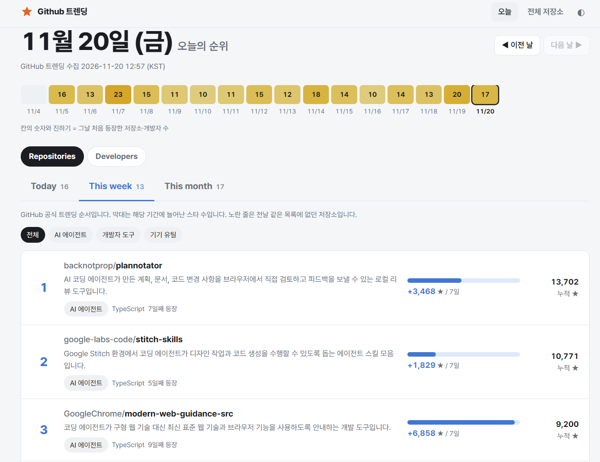
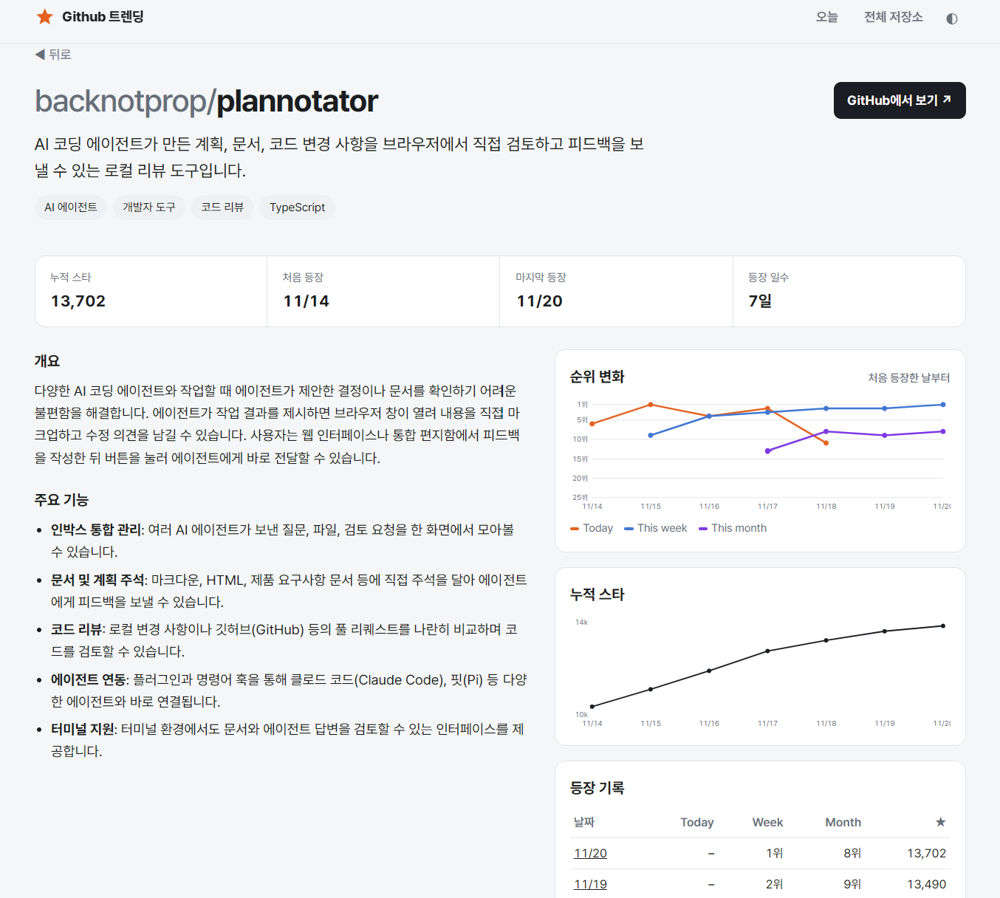
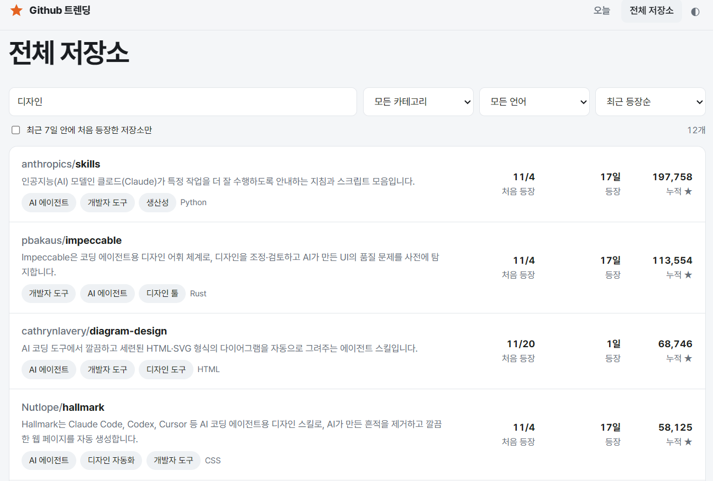

**한국어** | [English](README.en.md)

# git-trend-for-korean

> 매일 GitHub 공식 트렌딩 저장소를 수집하고, 주요 저장소의 README를 한국어로 요약해 웹사이트·Obsidian 노트·이메일로 제공하는 자동화 프로젝트.

🔗 **사이트: https://gittrendforkorean-site.vercel.app**



- **GitHub 공식 트렌딩 수집**: Repositories(Today·This week·This month)와 Developers(This week·This month) 목록을 매일 자동으로 수집합니다.
- **README 한국어 요약**: 새롭게 등장한 저장소의 README를 LLM(Gemini)을 활용해 한국어로 요약합니다. 한 번 요약한 저장소는 중복 처리하지 않습니다.
- **저장소별 이력 관리**: 저장소마다 Obsidian 노트를 생성하고, 트렌딩에 다시 등장할 때마다 날짜와 등장 기록을 누적합니다.
- **NEW 표시**: 전날 트렌딩 목록에 없었던 신규 저장소와 개발자를 구분해 표시합니다.
- **서버리스 자동화**: 별도의 서버 운영 없이 GitHub Actions와 Vercel을 활용해 데이터 수집부터 웹사이트 배포까지 자동으로 수행합니다.

## 💡 개발 배경

AI 기술과 오픈소스 생태계가 빠르게 발전하면서 매일 새로운 도구와 프로젝트가 등장하고 있습니다. 특히 GitHub 트렌딩은 최근 개발자들의 관심을 받고 있는 기술과 저장소를 파악할 수 있는 유용한 정보원입니다.

하지만 트렌딩에 소개되는 저장소 대부분은 영어로 설명되어 있어, 프로젝트의 목적과 주요 기능을 파악하려면 README를 하나씩 확인하고 번역하거나 LLM을 활용해 별도로 정리해야 하는 번거로움이 있었습니다. 또한 관심 있는 저장소를 발견하더라도 별도로 기록하지 않으면 이후 다시 등장했을 때 이를 알아차리거나 과거의 트렌드와 비교하기 어려웠습니다.

새로운 기술과 서비스를 빠르게 파악하는 것뿐만 아니라, 관심 있는 프로젝트를 지속적으로 추적하고 축적할 수 있는 환경이 필요하다고 생각했습니다. 이에 GitHub 트렌딩 수집부터 한국어 요약, 이력 관리, 결과 공유까지 이어지는 자동화 시스템을 개발했습니다.

## 🎯 해결 방법

매일 GitHub 공식 트렌딩 데이터를 자동으로 수집하고, 새롭게 등장한 저장소의 README를 한국어로 요약합니다. 수집 및 분석 결과는 세 가지 채널을 통해 확인할 수 있습니다.

- **웹사이트**: 날짜별 트렌딩 저장소와 개발자 목록, 신규 등장 여부 및 한국어 요약을 제공해 누구나 쉽게 확인할 수 있도록 구성
- **Obsidian 노트**: 저장소별 요약과 트렌딩 등장 이력을 누적해 관심 있는 프로젝트를 검색하고, 과거 기록을 다시 살펴볼 수 있도록 관리
- **이메일**: 매일 아침 주요 트렌딩 정보를 전달해 별도로 사이트에 접속하지 않아도 새로운 기술과 프로젝트를 확인할 수 있도록 구성

## 🚀 기대 효과

- **정보 접근성 향상**: 영어 README를 일일이 확인하지 않아도 프로젝트의 목적과 주요 기능을 한국어로 빠르게 파악
- **기술 트렌드 추적**: 날짜별 트렌딩 기록과 신규 등장 정보를 통해 최근 주목받는 기술 및 프로젝트의 변화 흐름 확인
- **지식 자산 축적**: 저장소별 요약과 등장 이력을 지속적으로 기록해 개인 기술 아카이브로 활용
- **정보 확인의 효율화**: 웹사이트와 이메일을 통해 필요한 정보를 원하는 방식으로 확인
- **운영 비용 최소화**: 별도 서버 구축 없이 GitHub Actions와 Vercel을 활용해 수집·처리·배포 자동화

## 📸 사용 예시

**① 오늘의 순위** — 날짜 칸에는 그날 처음 등장한 저장소·개발자 수가 표시되고, 칸을 누르면 해당 날짜의 순위로 이동합니다. Today·This week·This month 탭과 카테고리 필터로 목록을 나눠 보고, 전날 없던 저장소는 NEW로 구분됩니다.

**② 저장소 상세** — 한국어 개요와 주요 기능, 순위 변화·누적 스타 그래프, 날짜별 등장 기록을 한 화면에서 확인합니다.



**③ 전체 저장소** — 지금까지 수집한 저장소를 검색하고 카테고리·언어로 필터링하거나, 최근 7일 안에 처음 등장한 저장소만 볼 수 있습니다.



## 동작 흐름

```
GitHub Actions (매일 08:07 KST, 실패 대비 08:37·10:17·12:17 재시도)
  → github.com/trending 수집 (Repositories 3기간 + Developers 2기간)
  → 처음 본 저장소: GitHub API로 README 조회 → Gemini로 한국어 요약
  → vault/30-Trends/Repos/ 노트 생성·갱신, .trending-days/YYYY-MM-DD.json 저장
  → site/index.html 생성 → 커밋·푸시 → Vercel 자동 배포
  → Gmail로 그날 목록 발송
```

## 기술 스택

| 영역 | 사용 기술 |
|------|-----------|
| 수집·요약 | Python 3.12, httpx, Jinja2 |
| LLM | Gemini (OpenAI 호환 API) |
| 실행 | GitHub Actions (cron) |
| 배포 | Vercel (정적 사이트) |
| 기록 | Obsidian 볼트 (Markdown) |
| 품질 | pytest, ruff, gitleaks (pre-commit) |

## 구조

| 경로 | 내용 |
|------|------|
| `ai-worker/app/trending.py` | GitHub 트렌딩 페이지 수집·파싱 |
| `ai-worker/app/gittrend.py` | 요약, 노트·일별 데이터 생성 |
| `ai-worker/app/site.py` | 정적 사이트 생성 |
| `ai-worker/app/cli.py` | Actions에서 쓰는 명령 (`gittrend`, `site`, `send-mail`) |
| `ai-worker/prompts/`, `ai-worker/templates/` | LLM 프롬프트, 노트·메일·사이트 템플릿 |
| `site/` | 배포되는 사이트 |
| `vault/30-Trends/Repos/` | 저장소별 요약 노트 (Obsidian에서 열 수 있는 Markdown) |
| `vault/30-Trends/.trending-days/` | 날짜별 트렌딩 스냅샷 (JSON) |

## 직접 실행하기

### GitHub Actions

저장소를 포크한 뒤 아래 값을 설정하면 `.github/workflows/gittrend-daily.yml`이 매일 실행됩니다. Actions 화면에서 수동 실행도 됩니다.

| 종류 | 이름 | 용도 |
|------|------|------|
| Secret | `GEMINI_API_KEY` | README 요약 |
| Secret | `GMAIL_USER`, `GMAIL_APP_PASSWORD`, `MAIL_TO` | 메일 발송 |
| Variable | `SITE_URL` | 메일 속 링크 (비우면 GitHub로 연결) |

### 로컬

```bash
cp .env.example .env    # AI_WORKER_TOKEN(아무 값), LLM_*, GITHUB_TOKEN 채우기
set -a; . ./.env; set +a   # .env 값을 환경변수로 불러오기
cd ai-worker
pip install -e .
python -m app.cli gittrend --mail-out mail.json   # 수집·요약·사이트 생성
python -m app.cli site                            # 저장된 데이터로 사이트만 다시 생성
```

`LLM_PROVIDER=fake`로 두면 LLM을 호출하지 않고 가짜 요약으로 동작합니다.

### 테스트

```bash
cd ai-worker
pip install -e ".[dev]"
pytest -q
ruff check .
```

## 참고와 주의

- 트렌딩은 GitHub 페이지를 파싱해 가져오므로, GitHub가 페이지 구조를 바꾸면 수집이 실패할 수 있습니다.
- GitHub 예약 실행은 늦거나 빠지는 경우가 있어 여러 시각에 걸어 두고, 그날 이미 실행했으면 건너뜁니다.
- LLM 요청 한도에 걸리면 기다렸다가 다시 시도하고, 끝내 실패한 저장소는 GitHub 설명으로 대신 표시합니다.
